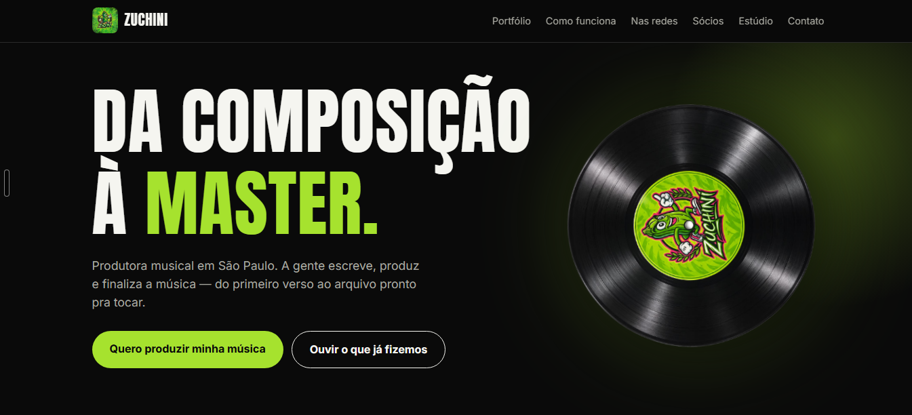

# Zuchini Music — site e bio-links

Site institucional da Zuchini Music e páginas individuais (formato "link da bio") dos três sócios — Guiggow, Gale e Leto.



## Estrutura

```
.
├── index.html       # site institucional da Zuchini Music
├── guiggow.html      # bio-link do Guiggow
├── gale.html         # bio-link do Gale
├── leto.html         # bio-link do Leto
├── assets/
│   ├── estilo.css    # estilo compartilhado do site institucional
│   ├── bio.css        # estilo compartilhado das páginas de bio-link
│   └── *.jpg, *.png  # fotos e logo
└── vercel.json        # URLs limpas (/guiggow em vez de /guiggow.html)
```

Site estático, sem build — basta abrir os arquivos `.html` num navegador ou publicar a pasta inteira.

## Publicação

Publicado na Vercel (projeto `site`, diretório raiz = esta pasta). Deploy manual via `vercel deploy --prod`, a partir da raiz deste repositório.

## Status

Protótipo de apresentação para os sócios. Contatos e itens marcados "a confirmar" nas páginas ainda não são dados reais — ver aviso dentro de cada página.
